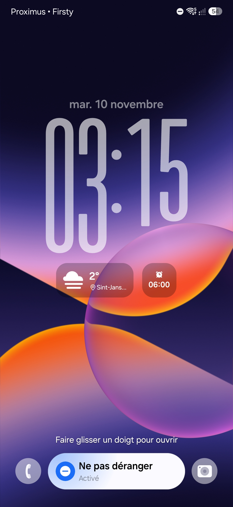

# A57 LiveBlur

> **AI disclosure:** This project was made with AI assistance (OpenAI Codex).

Samsung flagship live blur and color curves for the Galaxy A57 5G, packaged as a KernelSU + Zygisk module.

## Screenshots

| Enabled | Disabled |
|:---:|:---:|
|  |  |

## Compatibility

Built for **Samsung Galaxy A57 5G (SM-A576B), Android 17 / One UI 9**, on firmware **A576BXXS6BZJ2 / OXM6BZJ2**.

Requires **KernelSU** and a working **Zygisk** implementation, such as Zygisk Next. The installer checks the exact firmware fingerprint; other builds are unsupported.

## Download and install

[Download v1.5.1](https://github.com/hamzatuss/A57-LiveBlur/releases/download/v1.5.1/Samsung-Native-Live-Blur-v1.5.1.zip) · [SHA-256](https://github.com/hamzatuss/A57-LiveBlur/releases/download/v1.5.1/SHA256SUMS.txt)

1. Install the ZIP through KernelSU.
2. Fully reboot your phone.

Updates replace the existing `enable_live_blur` module. The installer also disables the old standalone `native_blur_renderer` module if present.

## What it does

Enables Samsung's native blur API and uses the original flagship SurfaceFlinger renderer for color curves. Supports eligible Samsung and third-party app processes, including shared framework dialogs. Apps must request the effect themselves; configured Zygisk exclusions still apply.

Version 1.5.1 fixes stale renderer mounts after updates that could make color curves disappear. System partitions are not flashed.

## Troubleshooting and removal

The module's **Action** button shows renderer status. If the flagship renderer fails its startup check, the module restores stock automatically; color curves will then be unavailable.

To view the renderer log:

```sh
su -c 'cat /data/adb/modules/enable_live_blur/renderer-status.log'
```

To remove the module, disable or uninstall **Samsung Native Live Blur** in KernelSU, then reboot.

## Source and development

[Module source](module/source) · [Build and test instructions](docs/development.md) · [Architecture](docs/architecture.md) · [Component notices](NOTICE.md)
