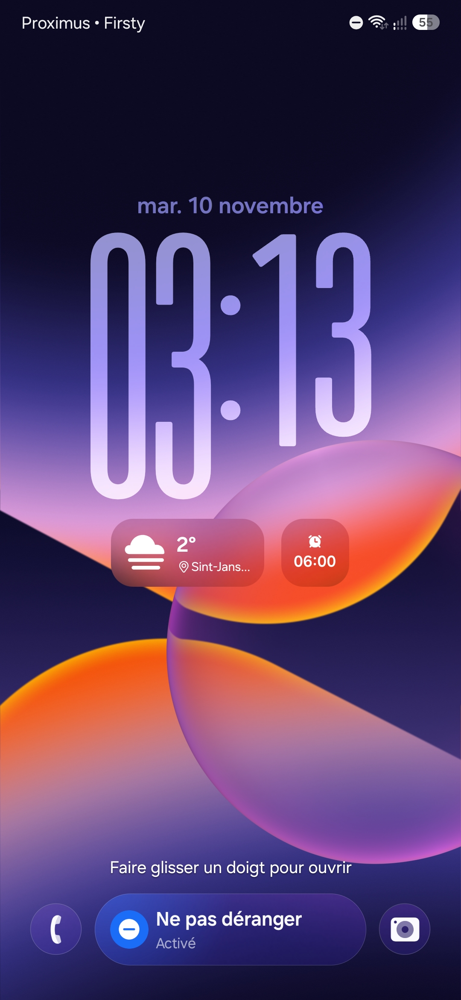
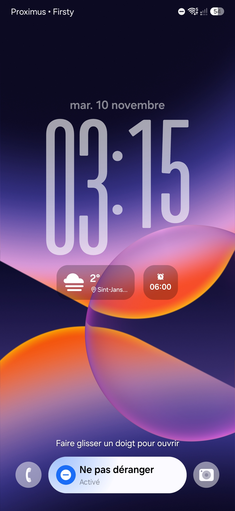

# A57 LiveBlur

> **AI disclosure:** This project was made with AI assistance (OpenAI Codex).

Samsung flagship live blur and color curves for the Galaxy A57 5G, packaged as a KernelSU + Zygisk module.

## Screenshots

| Enabled | Disabled |
|:---:|:---:|
|  |  |

## Compatibility

Built for **Samsung Galaxy A57 5G (SM-A576B), Android 17 / One UI 9**, on firmware **A576BXXS6BZJ2 / OXM6BZJ2**.

The installer checks the exact firmware fingerprint; other builds are unsupported.

## Requirements

- Samsung Galaxy A57 5G **SM-A576B** on the firmware listed above.
- Root access through **KernelSU**, with its manager installed.
- A working **Zygisk** implementation enabled, such as **Zygisk Next**.
- A full phone reboot after installation.

## Download and install

[Download v1.6.4](https://github.com/hamzatuss/A57-LiveBlur/releases/download/v1.6.4/Samsung-Native-Live-Blur-v1.6.4.zip) · [SHA-256](https://github.com/hamzatuss/A57-LiveBlur/releases/download/v1.6.4/SHA256SUMS.txt)

1. Install the ZIP through KernelSU.
2. Fully reboot your phone.

## What it does

Enables Samsung's native blur API and uses the original flagship SurfaceFlinger renderer for color curves. Supports eligible Samsung and third-party app processes, including shared framework dialogs. Apps must request the effect themselves; configured Zygisk exclusions still apply.

This release contains native blur and color curves with per-app exclusions, plus fullscreen AOD wallpaper and Samsung’s built-in AOD-to-lock-screen clock transition. After reboot, enable Always On Display and its wallpaper option in **Settings > Lock screen and AOD > Always On Display**. Available effects depend on the selected wallpaper, clock and AOD configuration.

Version 1.6.4 supplies the missing framework drawing resource used by Samsung’s AOD dimming layer, so its wallpaper-switch logic can run.

Everything is in one ZIP. If the standalone AOD FullScreen Enabler (`fullaodenable`) is installed, the installer disables it to prevent conflicting feature overlays. Fullscreen AOD can use more battery than a black AOD on this display. System partitions are not flashed. Older builds, including the discontinued AI/animation builds, are marked **Archived** in [Releases](https://github.com/hamzatuss/A57-LiveBlur/releases).

## Per-app exclusions

Edit `/data/adb/modules/enable_live_blur/excluded-apps.txt` as root to list apps that should not receive the blur bridge. Use one package name per line; its subprocesses are included. Restart the app after changes. Duck Detector (`com.eltavine.duckdetector`) is excluded by default. Excluded apps do not receive this module’s native blur support.

This setting prevents injection into excluded apps; it does not hide root, falsify scanner results, or remove mount artifacts created elsewhere.

## Troubleshooting and removal

The module's **Action** button shows renderer status. If the flagship renderer fails its startup check, the module restores stock automatically; color curves will then be unavailable.

To view the renderer log:

```sh
su -c 'cat /data/adb/modules/enable_live_blur/renderer-status.log'
```

To remove the module, disable or uninstall **Samsung Native Live Blur** in KernelSU, then reboot.

## Source and development

[Module source](module/source) · [Build and test instructions](docs/development.md) · [Architecture](docs/architecture.md) · [Component notices](NOTICE.md)
