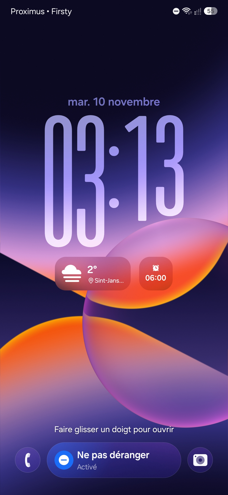

# A57 LiveBlur

> **AI disclosure:** This project was made with AI assistance (OpenAI Codex).

Samsung flagship live blur and color curves for the Galaxy A57 5G, packaged as a KernelSU + Zygisk module.

## Supported build

This release is specific to **SM-A576B, Android 17 / One UI 9**, with this firmware fingerprint:

`samsung/a57xnaeea/a57x:17/CP2A.260605.016/A576BXXS6BZJ2_OXM6BZJ2:user/release-keys`

The installer and JNI bridge check the fingerprint. Other firmware needs a separate compatibility review and rebuild.

## Download and install

[Download v1.5.1](https://github.com/hamzatuss/A57-LiveBlur/releases/download/v1.5.1/Samsung-Native-Live-Blur-v1.5.1.zip) · [SHA-256](https://github.com/hamzatuss/A57-LiveBlur/releases/download/v1.5.1/SHA256SUMS.txt)

1. Have KernelSU and a working Zygisk implementation enabled. The original setup used Zygisk Next.
2. Install the ZIP through KernelSU.
3. Perform a full phone reboot. A framework-only restart does not rerun KernelSU boot scripts.

The package updates the existing `enable_live_blur` module. During installation it disables the old standalone `native_blur_renderer` module, if present, to prevent duplicate renderer mounts. The package contains both components.

Version 1.5.1 fixes renderer startup after module updates: a retained bind mount could refer to a deleted executable even though its checksum still matched. Android then lost its graphics linker namespaces and the donor crashed; recovery restored stock, removing color curves. Startup now compares file identity and refreshes stale mounts. The failure and namespace recovery were reproduced with a harmless executable in a private mount namespace. Live UI confirmation of this release remains pending installation and a full reboot.

## Screenshots

| | |
|:---:|:---:|
|  |  |
| **Enabled** | **Disabled** |

## How it works

- Enables the required background-blur property and Samsung floating-feature XML flag.
- Hooks `SurfaceControl.nativeSetBlurRegionsEx` across eligible app processes, including Samsung apps, third-party apps and their subprocesses. It forwards each app’s requests to unchanged Samsung donor machine code. Core processes and child zygotes are excluded.
- Retains the stock installed `libandroid_runtime.so`. The donor is mapped separately during specialization, while module files are accessible. Its JNI caches initialize on the first blur API call, with thread-safe initialization and unrelated JNI registrations suppressed.
- Uses the original SurfaceFlinger from **SM-S942B S942BXXU5BZJA**. It contains Samsung's `ColorCurveEffect` shader, which is absent from the target A57 renderer.
- Selects `skiaglthreaded` before starting the renderer, matching the working Skia GLES/ANGLE path on this phone.
- Binds that renderer into init's mount namespace at boot. No system partition is flashed.

The donor's executable sections remain unchanged. Four unavailable, unrelated BLAST imports in the JNI donor have aborting guards; the tested blur calls did not use them. Native implementation provenance is recorded in [module/donor/PROVENANCE.json](module/donor/PROVENANCE.json) and [module/PROVENANCE.json](module/PROVENANCE.json).

## Rollback

The boot check verifies the running renderer hash and boot completion. It polls every 0.25 seconds and restores stock on the first service restarting state or loss of a confirmed donor process. Recovery first unmounts the donor; if that fails, it can bind the verified stock backup. It restarts the service only when stock is not already running. It sets `renderer-disabled`, leaving the JNI bridge enabled. An unfinished previous trial also skips the renderer on the next boot.

The module's **Action** button displays status without changing the renderer. To explicitly restore stock while keeping the JNI bridge, run `su -c 'sh /data/adb/modules/enable_live_blur/restore-renderer.sh'`. To undo the whole module, disable/remove `enable_live_blur` in KernelSU and reboot.

Installing an update clears stale renderer retry/disabled markers in the staged module. Boot trials record the kernel boot ID so repeated setup in the same boot is not mistaken for a failed previous boot.

Logs:

`su -c 'cat /data/adb/modules/enable_live_blur/renderer-status.log'`

`su -c 'logcat -d -s NativeBlurDonor'`

## Source and packaging

- [module/source](module/source): native source used by the module: Zygisk bridge, donor loader, guarded imports, and pinned Zygisk API header.
- [module](module): complete flashable module payload, including the working native binaries.
- [tools](tools): native build and ZIP packaging tools.
- [GitHub Releases](https://github.com/hamzatuss/A57-LiveBlur/releases): installable ZIP and checksum.

To repack the included payload with Node.js 24 or newer:

`node tools/package.js`

To rebuild the JNI bridge and loader in Termux on the supported phone, install Clang and Node.js, then run:

`sh tools/build-native.sh`

`node tools/package.js`

The build uses the included, pinned donor library and the phone's system libraries. It does not rebuild Samsung's proprietary renderer or donor runtime. Output goes to `dist/`, and packaging refreshes the payload checksum manifest. Building and packaging do not install the module.

## Startup regression checks

Build the harmless linker fixture in Termux first:

`mkdir -p build`

`clang -O2 -fPIE -pie tools/linker-namespace-fixture.c -ldl -Wl,--no-as-needed /system/lib64/libdl_android.so -Wl,--dynamic-linker=/system/bin/linker64 -o build/linker-namespace-fixture`

Then run:

`su -c '/data/data/com.termux/files/usr/bin/node tools/test-renderer-startup.js'`

Run from the repository directory on the supported phone. Tests use a private namespace and temporary files. Android property writes and display-service restart requests are mocked; installed modules and live properties remain unchanged. They cover backend selection before mount, failed-pin refusal, healthy adoption, stale-inode refresh after updates, real Android linker namespace loss/recovery, boot guards, immediate recovery, PID cleanup and backup-bind recovery.

## App coverage

Version 1.5.0 covers app processes generally instead of using a package allowlist. This includes the processes hosting Settings, My Files, Samsung Internet, Samsung Keyboard, other Samsung apps, third-party apps and shared framework dialogs/dropdowns. Apps and framework widgets still decide where to request Samsung blur and color curves. Zygisk must be enabled for the relevant app; configured Zygisk exclusions remain effective.

The server callback never installs a hook. Core system/process-launcher names and child-zygote specialization are also excluded. Ordinary app subprocesses and multi-user UID arguments are supported.

To run production-module scope, concurrent first-use and offscreen rendering tests in Termux on the supported phone with the flagship renderer active:

`node tools/test-native-blur.js`

The harness uses separate root app_process test runtimes, simulated specialization arguments and a private offscreen layer stack. It checks broader app scope, an unused API that leaves caches uninitialized, and an eight-thread first-use race that initializes once. Pixel samples verify ordinary blur and Samsung color curves. These tests do not substitute for live APK testing under each app’s sandbox.

## Validation and provenance

The original investigation verified LP geometry/metadata SHA-256, the complete Android firmware package's ZIP CRC and length, renderer dependencies and symbols, layer-state layout/defaults, isolated renderer rollback, unfinished-trial handling, and read-only executable mount flags. Earlier offscreen tests showed ordinary blur working while color-curve parameters had no visual effect with the A57 renderer.

Build-specific measurements and provenance are in [docs/architecture.md](docs/architecture.md). Samsung binaries remain Samsung components; this repository does not claim ownership of them. The included Zygisk API header retains its upstream copyright and permission notice.
